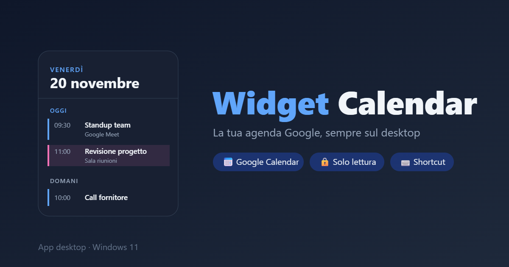
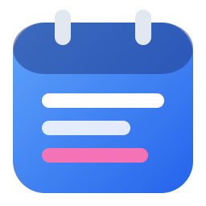
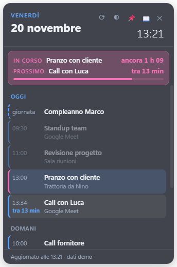
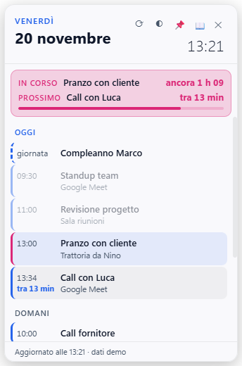

<p align="center">
  
</p>

<p align="center">
  
</p>

<h1 align="center">Widget Calendar</h1>

<p align="center">
  Your Google Calendar agenda, always visible on the Windows 11 desktop.<br>
  <a href="README.md">IT</a> | <b>EN</b>
</p>

---

## Overview

Widget Calendar is a small transparent window that sits on your desktop and shows today's and the coming days' events from your Google Calendar. It refreshes on its own, starts with Windows and needs no login: it reads the calendar's secret iCal address, read-only.

## Key features

- 📅 Agenda for today and the coming days, grouped by day ("Today", "Tomorrow", …)
- 🔁 Recurring events, exceptions and cancellations handled correctly
- 🕐 Clock and a "next event in N min" signal that changes colour as it gets closer
- 🎯 Current event highlighted, past events dimmed
- 🗂️ Several calendars (work + personal) merged into one list, without duplicates
- 🌗 Dark and light theme; position and size are remembered
- 🖱️ Click an event → opens that day in Google Calendar
- 🚀 Starts with Windows, tray icon
- 🔒 Read-only, no Google Cloud project, no open ports

## Install and run

Requirements: Windows 11, [Node.js](https://nodejs.org) 20 or later.

```powershell
git clone https://github.com/ripu/widget-calendar-public.git "Widget Calendar"
cd "Widget Calendar"
npm install
copy .env.example .env
```

Open `.env` and paste your calendar's secret address into `ICAL_URL`:
**Google Calendar → ⚙️ Settings → (your calendar) → Integrate calendar → Secret address in iCal format**.

```powershell
npm start          # run the widget
npm run demo       # try it with sample data, no calendar needed
```

To start with Windows: right-click the tray icon → **Avvia con Windows** (Start with Windows).

| `.env` variable | Default | Meaning |
| --- | --- | --- |
| `ICAL_URL` | — | Secret iCal address of the main calendar |
| `ICAL_URL_2`, `_3`, … | — | More calendars (e.g. your personal one); an event found in several calendars shows up once |
| `DAYS` | `7` | Days shown starting from today |
| `REFRESH_MIN` | `5` | Minutes between refreshes |

> ⚠️ The secret address grants read access to your calendar: do not share it. `.env` is excluded from git.

## Tech stack

- [Electron](https://www.electronjs.org) 45: frameless, transparent desktop window
- [node-ical](https://github.com/jens-maus/node-ical): iCal parsing and recurrence expansion
- Vanilla HTML/CSS/JS renderer, no framework

## Keyboard shortcuts

| Key | Action |
| --- | --- |
| `Ctrl+Alt+C` | Show / hide the widget (from any app) |
| `R` | Refresh now |
| `T` | Light / dark theme |
| `P` | Always on top |
| `Esc` | Hide the widget |
| `Tab` / `Enter` | Move through events / open the day in Google Calendar |

## Logs and debugging

Logs go to `log/YYYY-MM-DD.txt`, one file per day. They hold main-process events and, prefixed with `[BROWSER:…]`, interface events, together with download, parse and render timings. The calendar token is never written to the logs.

If `npm start` opens no window from a VS Code terminal, remove `ELECTRON_RUN_AS_NODE`: `Remove-Item Env:ELECTRON_RUN_AS_NODE`.

## License

[MIT](LICENSE)

## Screenshots

<p>
  
  
</p>

<sub>Screenshots taken in demo mode (Italian UI).</sub>
