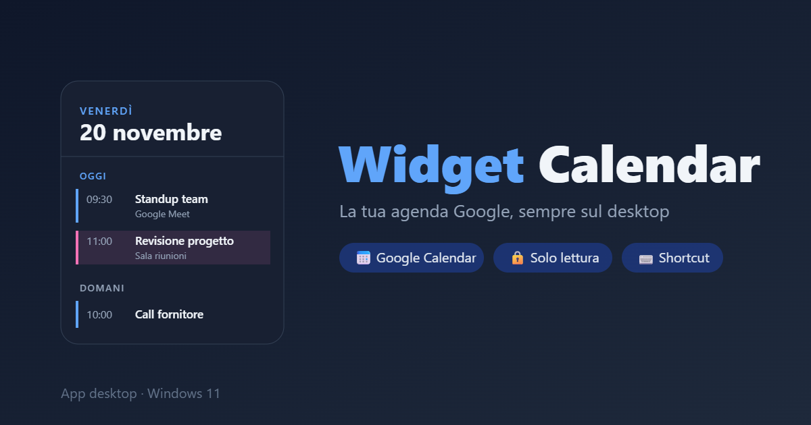
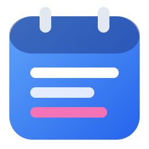
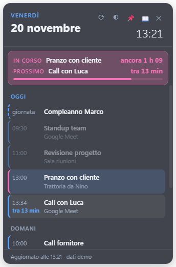
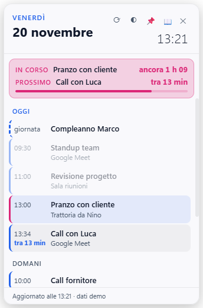

<p align="center">
  
</p>

<p align="center">
  
</p>

<h1 align="center">Widget Calendar</h1>

<p align="center">
  La tua agenda Google Calendar, sempre visibile sul desktop di Windows 11.<br>
  <b>IT</b> | <a href="README.en.md">EN</a>
</p>

---

## Overview

Widget Calendar è una piccola finestra trasparente che vive sul desktop e mostra gli impegni di oggi e dei prossimi giorni, letti dal tuo Google Calendar. Si aggiorna da sola, parte con Windows e non richiede login: usa l'indirizzo segreto iCal del calendario, in sola lettura.

## Funzionalità principali

- 📅 Agenda di oggi e dei prossimi giorni, raggruppata per giorno («Oggi», «Domani», …)
- 🔁 Eventi ricorrenti, eccezioni e cancellazioni gestiti correttamente
- 🕐 Orologio e segnale «prossimo evento tra N min», che cambia colore man mano che si avvicina
- 🎯 Evento in corso evidenziato, eventi passati attenuati
- 🗂️ Più calendari (lavoro + personale) uniti in un'unica lista, senza doppioni
- 🌗 Tema scuro e chiaro, posizione e dimensione ricordate
- 🖱️ Clic su un evento → apre quel giorno in Google Calendar
- 🚀 Avvio automatico con Windows, icona nella tray
- 🔒 Sola lettura, nessun account Google Cloud, nessuna porta aperta

## Installazione e avvio

Requisiti: Windows 11, [Node.js](https://nodejs.org) 20 o successivo.

```powershell
git clone https://github.com/ripu/widget-calendar-public.git "Widget Calendar"
cd "Widget Calendar"
npm install
copy .env.example .env
```

Apri `.env` e incolla in `ICAL_URL` l'indirizzo segreto del tuo calendario:
**Google Calendar → ⚙️ Impostazioni → (il tuo calendario) → Integra calendario → Indirizzo segreto in formato iCal**.

```powershell
npm start          # avvia il widget
npm run demo       # prova con dati di esempio, senza calendario
```

Per l'avvio automatico: clic destro sull'icona nella tray → **Avvia con Windows**.

| Variabile `.env` | Default | Significato |
| --- | --- | --- |
| `ICAL_URL` | — | Indirizzo segreto iCal del calendario principale |
| `ICAL_URL_2`, `_3`, … | — | Altri calendari (es. quello personale); un evento presente in più calendari compare una volta sola |
| `DAYS` | `7` | Giorni mostrati a partire da oggi |
| `REFRESH_MIN` | `5` | Minuti tra un aggiornamento e l'altro |

> ⚠️ L'indirizzo segreto dà accesso in lettura al tuo calendario: non condividerlo. Il file `.env` è escluso da git.

## Stack tecnologico

- [Electron](https://www.electronjs.org) 45: finestra desktop frameless e trasparente
- [node-ical](https://github.com/jens-maus/node-ical): parsing iCal ed espansione delle ricorrenze
- HTML/CSS/JS vanilla nel renderer, nessun framework

## Shortcut da tastiera

| Tasto | Azione |
| --- | --- |
| `Ctrl+Alt+C` | Mostra / nasconde il widget (da qualunque app) |
| `R` | Aggiorna ora |
| `T` | Tema chiaro / scuro |
| `P` | Sempre in primo piano |
| `Esc` | Nasconde il widget |
| `Tab` / `Invio` | Scorre gli eventi / apre il giorno in Google Calendar |

## Log e debug

I log vanno in `log/AAAA-MM-GG.txt`, un file al giorno. Contengono gli eventi del processo principale e, con prefisso `[BROWSER:…]`, quelli dell'interfaccia, insieme ai tempi di download, parsing e rendering. Il token del calendario non viene mai scritto nei log.

Se `npm start` non apre nessuna finestra in un terminale di VS Code, rimuovi `ELECTRON_RUN_AS_NODE`: `Remove-Item Env:ELECTRON_RUN_AS_NODE`.

## Licenza

[MIT](LICENSE)

## Screenshot

<p>
  
  
</p>

<sub>Screenshot generati in modalità demo.</sub>
